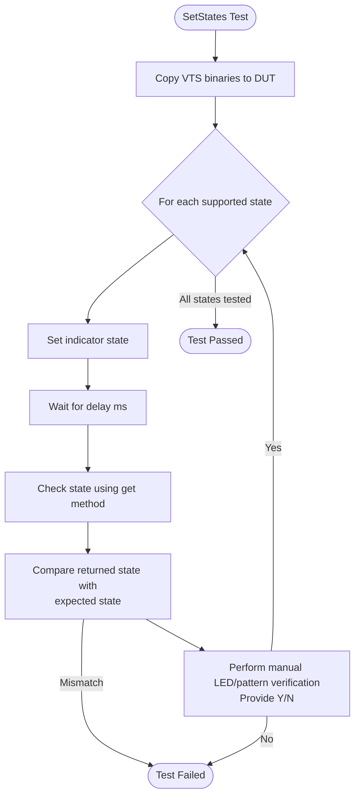
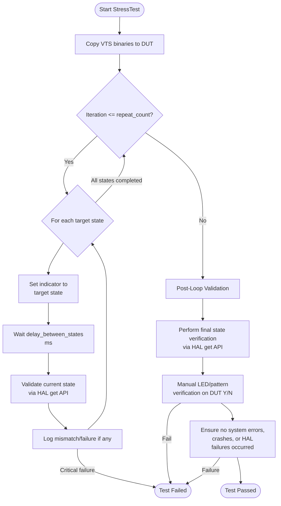

# INDICATOR L3 Low Level Test Specification

## Table of Contents

- [Overview](#overview)
- [Acronyms, Terms and Abbreviations](#acronyms-terms-and-abbreviations)
- [References](#references)
- [Level 3 Test Specification](#level-3-test-specification)
    - [DUT Side Implementation](#dut-side-implementation)

## Overview

This document defines the Level 3 (L3) Low-Level Test Specification for validating the Indicator functionality in the Device Under Test (DUT).

L3 testing focuses on low-level, state-accurate indicator functionality to ensure:

 - Supported indicator states can be set successfully.
 - HAL returns accurate state information.
 - The DUT remains stable and responsive during sustained or repetitive indicator state transitions.

All tests are executed using automated VTS and RAFT frameworks.

### Acronyms, Terms and Abbreviations

- `HAL`    - Hardware Abstraction Layer
- `VTS`    - Vendor Test Suite
- `L3`     - Level 3 Testing
- `DUT`    - Device Under Test
- `RAFT`   - Rapid Automation Framework for Testing
- `YAML`   - YAML Ain't Markup Language
- `AIDL`   - Android Interface Definition Language

### References

- `High Level Test Specification` - [indicator_High-Level_TestSpecification.md](indicator_High-Level_TestSpecification.md)
- [INDICATOR AIDL interface](https://github.com/rdkcentral/rdk-halif-aidl/tree/0.15.0/indicator/)

## Level 3 Test Specification

### `DUT` Side Implementation

The `VTS` binary running on the DUT provides two key L3 capabilities:

- SetStates – Validate support for all indicator states.
- StressTest – Validate system stability by repeatedly toggling all indicator states.

#### SetStates

##### Objective

Verify that:

 - All supported indicator states defined in the configuration file can be applied successfully.
 - `HAL` accurately reports the applied state via `get()`.
 - State transitions settle within the configured delay period.
 - This test ensures the correctness of each individual state the DUT supports.

##### Flow



##### Configuration File (YAML)

`SetStates` uses the following test configuration file to set the indicator states:

```yaml
Indicator:
  L3:
    SetStates:
      Parameters:
        state: [PSU_FAILURE]
        repeat: 1
        delay: 50
```
- **state:** List of indicator states to be applied on the DUT.
- **repeat:** Number of times the test must apply the given state(s).
- **delay:** Delay (in milliseconds) between consecutive set operations.

### Test Validation Configuration File (YAML)

```yaml
Indicator:
    States:
        BOOT:
            pattern: "LED_ON"
            color: [RED]
        ACTIVE:
            pattern: "LED_OFF"
            color: [GREEN]
        "OFF":
            pattern: "LED_OFF"
            color: []
        STANDBY:
            pattern: "LED_ON"
            color: [YELLOW]
        DEEP_SLEEP:
            pattern: "LED_ON"
            color: [BLUE]
        USB_UPGRADE:
            pattern: "SLOW_BLINK"
            color: [WHITE]
            timing: [300, 300] # duration for ON and OFF state in msec
        PSU_FAILURE:
            pattern: "FAST_BLINK"
            color: [RED, WHITE, YELLOW]
            timing: [200, 200, 100] #in msec
            transition: ["FADE_OUT"]
```

#### StressTest

##### Objective

Validates the robustness of the Indicator HAL by continuously toggling the indicator state and reading it back over an extended number of iterations, as defined in the configuration file. This test ensures that repeated state transitions do not lead to failures, unexpected behavior, or HAL instability.

##### Flow



##### Configuration File (YAML)

`StressTest` uses the following test configuration file to set states:

```yaml
Indicator:
  L3:
    SetStates:
      Parameters:
        state: [PSU_FAILURE,ACTIVE,OFF,STANDBY]
        repeat: 1
        delay: 50
```

### Test Validation Configuration File (YAML)

```yaml
Indicator:
    States:
        BOOT:
            pattern: "LED_ON"
            color: [RED]
        ACTIVE:
            pattern: "LED_OFF"
            color: [GREEN]
        "OFF":
            pattern: "LED_OFF"
            color: []
        STANDBY:
            pattern: "LED_ON"
            color: [YELLOW]
        DEEP_SLEEP:
            pattern: "LED_ON"
            color: [BLUE]
        USB_UPGRADE:
            pattern: "SLOW_BLINK"
            color: [WHITE]
            timing: [300, 300] # duration for ON and OFF state in msec
        PSU_FAILURE:
            pattern: "FAST_BLINK"
            color: [RED, WHITE, YELLOW]
            timing: [200, 200, 100] #in msec
            transition: ["FADE_OUT"]
```
